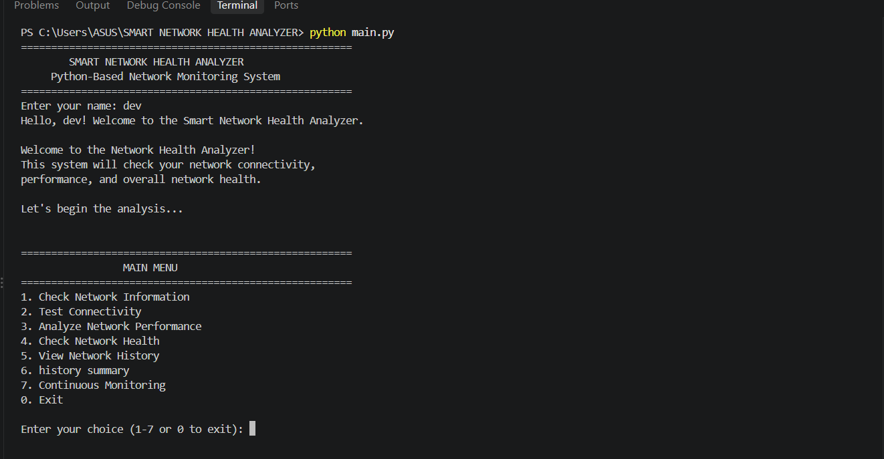
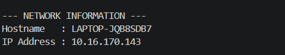
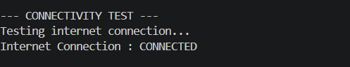
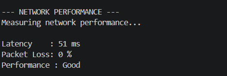
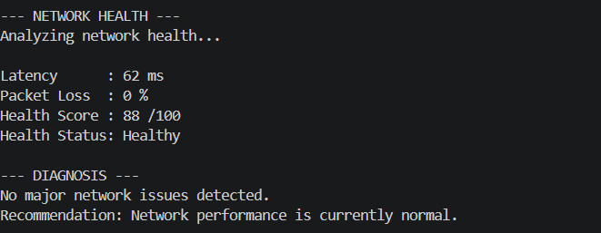
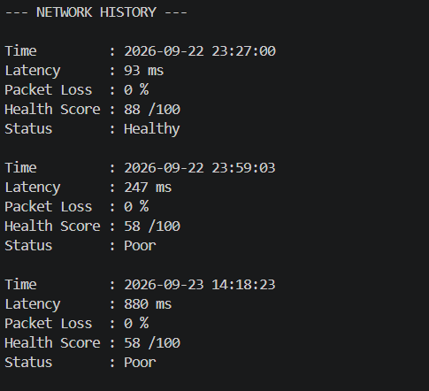
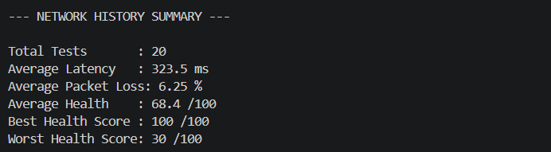
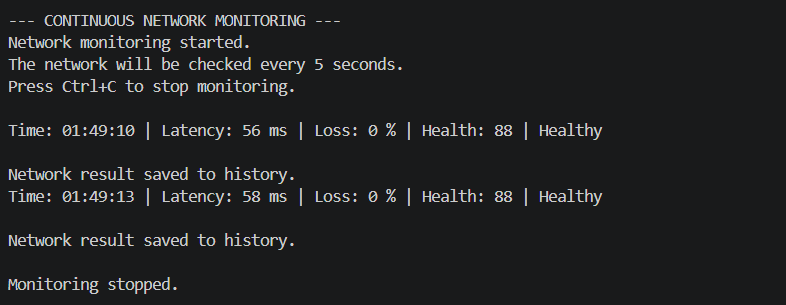

# SMART NETWORK HEALTH ANALYZER

## A Python-Based Network Monitoring and Diagnostic System

### Python Essentials Project

---

### Submitted By

Name: __DEVANG MODI________________________

Registration Number: ____26BAI11023___________________

Program: B.Tech Computer Science and Engineering

Year: First Year

### Course

Python Essentials

### Institution

VIT Bhopal University

### Academic Year

2026–2027

---

## Project Report

This project presents a Python-based command-line system designed to monitor, analyze, and diagnose basic network performance.

---

## 1. Introduction

Network connectivity has become an important part of everyday computing. Slow response times, packet loss, and unstable connections can affect browsing, online communication, file transfers, and other network-based activities.

The Smart Network Health Analyzer is a Python-based command-line application developed to provide a simple way to examine basic network performance. The system collects network information, tests connectivity, measures latency and packet loss, calculates a network health score, and identifies possible network issues using predefined rules.

The project uses a modular structure in which different tasks are handled by separate Python modules. It also provides network history and continuous monitoring features so that users can observe network performance over multiple tests.

The main purpose of this project is to apply Python programming concepts to a practical networking problem while developing a structured, testable, and maintainable software application.

## 2. Problem Statement

Network problems are often difficult for users to understand because a slow internet connection can be caused by different factors such as high latency, packet loss, or temporary network instability.

Basic network commands can provide raw information, but they may not give users a simple overall interpretation of the network condition.

The Smart Network Health Analyzer addresses this problem by collecting basic network performance data and converting it into an understandable health assessment. The system measures latency and packet loss, calculates a health score, classifies the network condition, and provides rule-based diagnostic information.

The project is intended to provide a simple command-line tool that helps users understand the current condition of their network without requiring advanced networking knowledge.

## 3. Functional Requirements

The Smart Network Health Analyzer provides the following functional requirements:

1. The system shall display a main menu for selecting different network analysis operations.

2. The system shall collect basic network information such as hostname and IP address.

3. The system shall test internet connectivity using a ping-based test.

4. The system shall measure network latency and packet loss.

5. The system shall calculate a network health score based on latency and packet loss.

6. The system shall classify the network condition as Healthy, Moderate, Poor, or Critical.

7. The system shall identify possible network problems using predefined diagnostic rules.

8. The system shall provide recommendations based on detected network conditions.

9. The system shall save network analysis results in a JSON history file.

10. The system shall display previous network results and provide a history summary.

11. The system shall support continuous network monitoring at regular intervals.

12. The system shall allow the user to exit the application through the main menu.

## 4. Non-Functional Requirements

The project has the following non-functional requirements:

1. Performance
   The system should provide network analysis results within a reasonable amount of time.

2. Reliability
   The system should handle common network errors and testing failures without unexpectedly terminating.

3. Usability
   The command-line interface should be simple and easy to understand for users with basic computer knowledge.

4. Maintainability
   The application should use separate modules so that individual components can be modified and tested easily.

5. Portability
   The project should be structured so that it can be adapted to other operating systems in future versions.

6. Data Integrity
   Network history should be stored in a structured format while preserving previously recorded results.

## 5. System Architecture

The Smart Network Health Analyzer follows a modular architecture. The main program acts as the central controller and communicates with separate modules responsible for different network analysis tasks.

The overall flow of the system is:

User
  ↓
Command-Line Interface
  ↓
Network Information
  ↓
Connectivity and Performance Analysis
  ↓
Latency and Packet Loss
  ↓
Health Score Engine
  ↓
Health Status
  ↓
Diagnosis Engine
  ↓
Result and Recommendation
  ↓
History and Monitoring

The modular architecture makes the application easier to understand, test, maintain, and extend.

The main components are:

- `main.py` — Controls the menu and coordinates the application.
- `network_info.py` — Collects basic network information.
- `connectivity.py` — Tests network connectivity.
- `network_data.py` — Collects latency and packet loss.
- `performance.py` — Analyzes network performance.
- `health_score.py` — Calculates the health score and status.
- `diagnosis.py` — Identifies possible network issues.
- `history.py` — Stores and displays network history.
- `monitor.py` — Performs continuous network monitoring.

The architecture diagram is included in the `documentation` folder.

## 6. Design Diagrams

The project uses diagrams to represent the architecture and workflow of the Smart Network Health Analyzer.

### 6.1 System Architecture Diagram

The system architecture diagram represents the major components of the application and shows how the different modules interact with each other.

The architecture diagram is available in:

`documentation/architecture diagram.png`

### 6.2 Workflow Diagram

The workflow diagram represents the sequence of operations performed by the application, starting from the main menu and continuing through network data collection, analysis, health scoring, diagnosis, result display, and history storage.

The workflow diagram is available in the `documentation` folder.

### 6.3 Use Case Diagram

The Use Case Diagram shows how the user interacts with the Smart Network Health Analyzer. It represents the major operations available to the user, including viewing network information, testing connectivity, analyzing performance, checking the health score, viewing diagnosis and recommendations, reviewing network history, and starting or stopping continuous monitoring.

The diagram also shows the supporting system operations used to collect network data, calculate the health score, load historical data, and perform continuous monitoring.

## 7. Design Decisions and Rationale

### 7.1 Modular Programming

The project is divided into separate modules based on their responsibilities. This makes the code easier to understand, test, maintain, and modify.

### 7.2 Command-Line Interface

A command-line interface was selected because it is lightweight, simple to use, and suitable for demonstrating the Python programming concepts used in the project.

### 7.3 Rule-Based Analysis

Predefined rules are used to evaluate latency and packet loss. These rules convert raw network measurements into a simple health status and provide possible diagnostic information.

### 7.4 JSON-Based Storage

JSON is used to store network history because it provides a simple structured format and can be handled using Python's standard library.

### 7.5 Separate Monitoring Module

Continuous monitoring is implemented as a separate module so that repeated network checks and history recording do not make the main program unnecessarily complex.

## 8. Implementation Details

The Smart Network Health Analyzer is implemented using Python and follows a modular programming approach.

### 8.1 Main Program

The `main.py` file provides the main menu and controls the overall flow of the application. It calls the required functions from the different modules based on the user's selection.

### 8.2 Network Information

The `network_info.py` module collects basic information such as the computer hostname and IP address.

### 8.3 Connectivity Testing

The `connectivity.py` module performs a ping-based connectivity test to determine whether the system can reach the test destination.

### 8.4 Network Data Collection

The `network_data.py` module collects latency and packet loss values from the network test and returns the data for further analysis.

### 8.5 Performance Analysis

The `performance.py` module analyzes the collected network measurements and provides a basic performance rating.

### 8.6 Health Score

The `health_score.py` module calculates a network health score using latency and packet loss. The result is classified as Healthy, Moderate, Poor, or Critical according to the project's predefined rules.

### 8.7 Diagnosis

The `diagnosis.py` module uses predefined conditions to identify possible network problems and provide recommendations.

### 8.8 History Management

The `history.py` module stores network results in `history.json` and provides functions for viewing previous results and calculating a history summary.

### 8.9 Continuous Monitoring

The `monitor.py` module repeatedly collects network measurements at regular intervals. Each successful measurement is analyzed and saved to the network history.

### 8.10 Testing

The project uses Python's built-in `unittest` framework. The test file checks important health score calculations and health status classifications.

## 9. Screenshots and Results

The application was tested through the command-line interface using different features of the Smart Network Health Analyzer.

### 9.1 Main Menu

The main menu provides access to the different network analysis functions, including network information, connectivity testing, performance analysis, health checking, history, history summary, and continuous monitoring.

### 9.2 Network Information

The system successfully displayed basic network information such as the hostname and IP address.

### 9.3 Connectivity Test

The connectivity module successfully tested the network connection and displayed the connection status.

### 9.4 Performance Analysis

The system successfully measured latency and packet loss and provided a performance rating based on the measured values.

### 9.5 Network Health Analysis

The system calculated a health score and displayed the corresponding health status. For example, during testing, a network measurement produced a health score of 48/100 and was classified as Poor.

### 9.6 Network History

The system successfully saved network test results to `history.json` and displayed previously recorded results.

### 9.7 History Summary

The history summary displayed information calculated from previously stored network measurements.

### 9.8 Continuous Monitoring

The monitoring module successfully performed repeated network checks and displayed the time, latency, packet loss, health score, and status.

## 10. Testing Approach

Testing was performed to verify that the major functions of the Smart Network Health Analyzer work correctly.

### 10.1 Testing Method

The project was tested using both manual testing and Python's built-in `unittest` framework.

Manual testing was used to check the complete application workflow through the command-line menu. Unit testing was used to verify important health score and status calculations.

### 10.2 Test Cases

| Test Case | Input / Action | Expected Result | Status |
|---|---|---|---|
| TC01 | Select Network Information | Hostname and IP address are displayed | Pass |
| TC02 | Select Connectivity Test | Connection status is displayed | Pass |
| TC03 | Select Performance Analysis | Latency, packet loss and rating are displayed | Pass |
| TC04 | Select Network Health | Health score and status are displayed | Pass |
| TC05 | Select View History | Previous network results are displayed | Pass |
| TC06 | Select History Summary | Average and best/worst results are displayed | Pass |
| TC07 | Select Continuous Monitoring | Network measurements are repeatedly displayed | Pass |
| TC08 | Run unit tests | All implemented tests pass successfully | Pass |

### 10.3 Unit Testing

The project uses Python's `unittest` framework to test the health score calculation and health status classification.

The tests were executed using:

python -m unittest discover tests

The implemented tests completed successfully.

### 10.4 Testing Result

The testing confirmed that the major modules of the application work together correctly and that the main network analysis workflow produces the expected results.

## 11. Challenges Faced

During the development of the Smart Network Health Analyzer, several practical challenges were encountered.

### 11.1 Collecting Network Data

Obtaining latency and packet loss values required using the system's ping command and processing its output.

### 11.2 Handling Different Network Conditions

Network performance can change depending on the connection and network load. Therefore, the application needed to handle different latency and packet loss values.

### 11.3 Processing Command Output

The output produced by the ping command had to be processed to extract useful values such as latency and packet loss.

### 11.4 Modularizing the Project

As the number of features increased, the program became easier to manage by dividing the functionality into separate Python modules.

### 11.5 Continuous Monitoring

Implementing continuous monitoring required repeated network testing, displaying updated results, saving the results, and allowing the user to stop monitoring safely.

### 11.6 Maintaining Network History

The application needed a simple method to store previous results. JSON was selected because it is easy to read, write, and process using Python.

## 12. Learnings and Key Takeaways

Developing the Smart Network Health Analyzer provided practical experience with Python programming and basic network analysis.

### 12.1 Python Modules

I learned how to divide a large program into smaller modules so that each module can perform a specific task.

### 12.2 System Commands

I learned how Python can interact with system commands using the `subprocess` module.

### 12.3 Network Data Analysis

I learned how latency and packet loss can be collected and used to understand basic network performance.

### 12.4 Conditional Logic

I learned how conditional statements can be used to classify network performance and identify possible problems.

### 12.5 Data Storage

I learned how JSON files can be used to store and retrieve structured network history.

### 12.6 Error Handling

I learned how exceptions can be handled so that the application can respond safely to problems such as unavailable network data or command timeouts.

### 12.7 Continuous Monitoring

I learned how loops and time delays can be used to repeatedly monitor changing network conditions.

### 12.8 Testing

I learned how Python's `unittest` framework can be used to check whether important parts of a program work as expected.

### 12.9 Project Development

This project improved my understanding of modular programming, problem solving, debugging, testing, documentation, and version control using Git and GitHub.

## 13. Future Enhancements

The current project provides basic network monitoring and diagnosis features. The system can be further improved with additional features.

### 13.1 Cross-Platform Support

The application can be modified to support Windows, Linux, and macOS with appropriate system commands.

### 13.2 Graphical User Interface

A graphical interface can be added to make the application easier to use for users who prefer visual dashboards.

### 13.3 Network Performance Graphs

Graphs can be added to show changes in latency, packet loss, and health score over time.

### 13.4 Advanced Network Statistics

Additional information such as download speed, upload speed, DNS response time, and connection stability can be included.

### 13.5 More Diagnostic Rules

More rules can be added to identify different types of network problems and provide more specific recommendations.

### 13.6 Report Export

The application can be enhanced to export network analysis results in formats such as CSV or PDF.

### 13.7 Database Storage

JSON storage can be replaced or supported by a database for handling a larger amount of network history.

### 13.8 Alerts

The system can be enhanced to notify the user when network performance becomes significantly poor or unstable.

## 14. References

The following resources were used to understand Python programming, system commands, data storage, and testing during the development of this project.

1. Python Documentation — https://docs.python.org/3/
2. Python `subprocess` Module Documentation — https://docs.python.org/3/library/subprocess.html
3. Python `json` Module Documentation — https://docs.python.org/3/library/json.html
4. Python `unittest` Module Documentation — https://docs.python.org/3/library/unittest.html
5. Python `socket` Module Documentation — https://docs.python.org/3/library/socket.html

